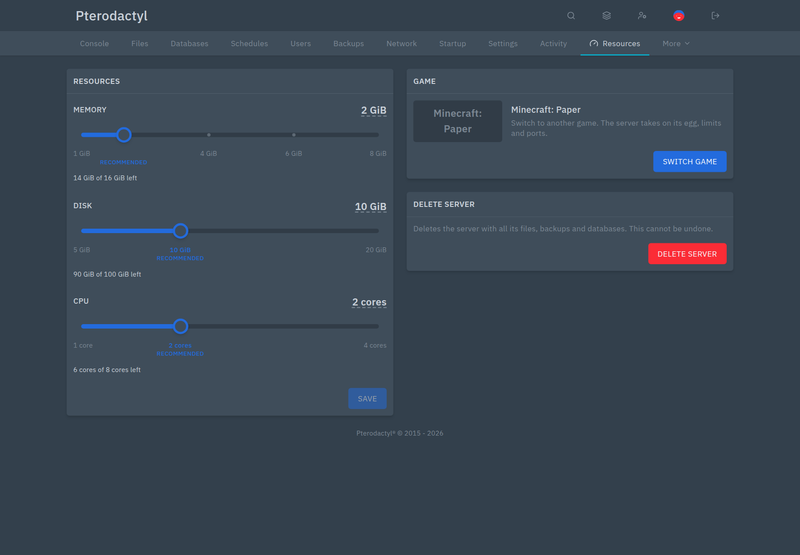

# Server Creator for Pterodactyl

Let users create their own servers within a quota, and duplicate servers in one click.

## Install

1. Download `server-creator-<version>.pteroext` from the [latest release](https://github.com/CCBlueX/Pterodactyl-Extension-Server-Creator/releases/latest).
2. Install and enable it under **Admin → Extensions**.
3. Under **Admin → Server Creator**, add a game (or pick one under **Popular games**) and give users a quota.

## Features

- **Game picker**: users pick a game, then size it with sliders in GiB and cores, or click the size to type it. Shows what's left and marks a recommended size.
- **Popular games**: Counter-Strike 2, Valheim, Terraria, Palworld, Project Zomboid and more come with sizes and artwork. Missing eggs are imported from the Pterodactyl egg catalog.
- **Games with several ports**: a game can give each server ports in a row and write the extra ones into egg variables.
- **Port ranges**: limit a game to ports such as `25565-25600`, so each game gets its own ports on a shared node.
- **Quotas**: limit servers, memory, disk, CPU, databases, backups and ports, for everyone or per user.
- **Resources page**: owners resize, switch to another game and delete (opt-in) on their server's Resources page. A switch brings the new game's egg, limits and ports, and egg changes from other extensions keep the game and ports in step.
- **Safe placement**: new servers only go to nodes with room, in the locations you choose.
- **Duplicate**: copy any server from its admin page, optionally with all its files.

Users only see the **Create server** button once their quota allows at least one server. The default quota is 0.

---

Inspired by the Pelican plugins User Creatable Servers, User Game Server Creator, Egg Images and Duplicate Server.
