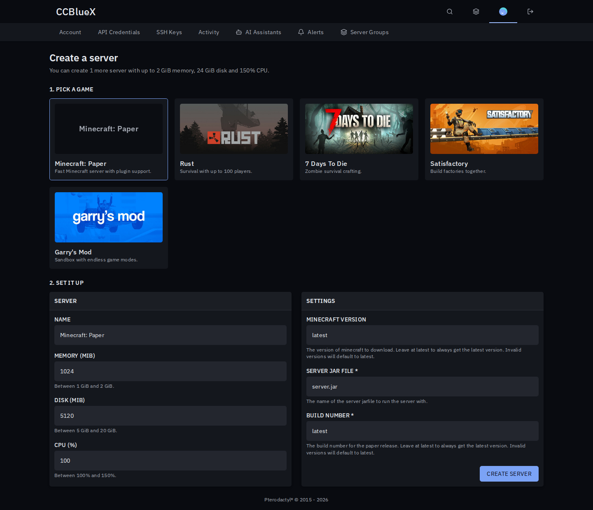
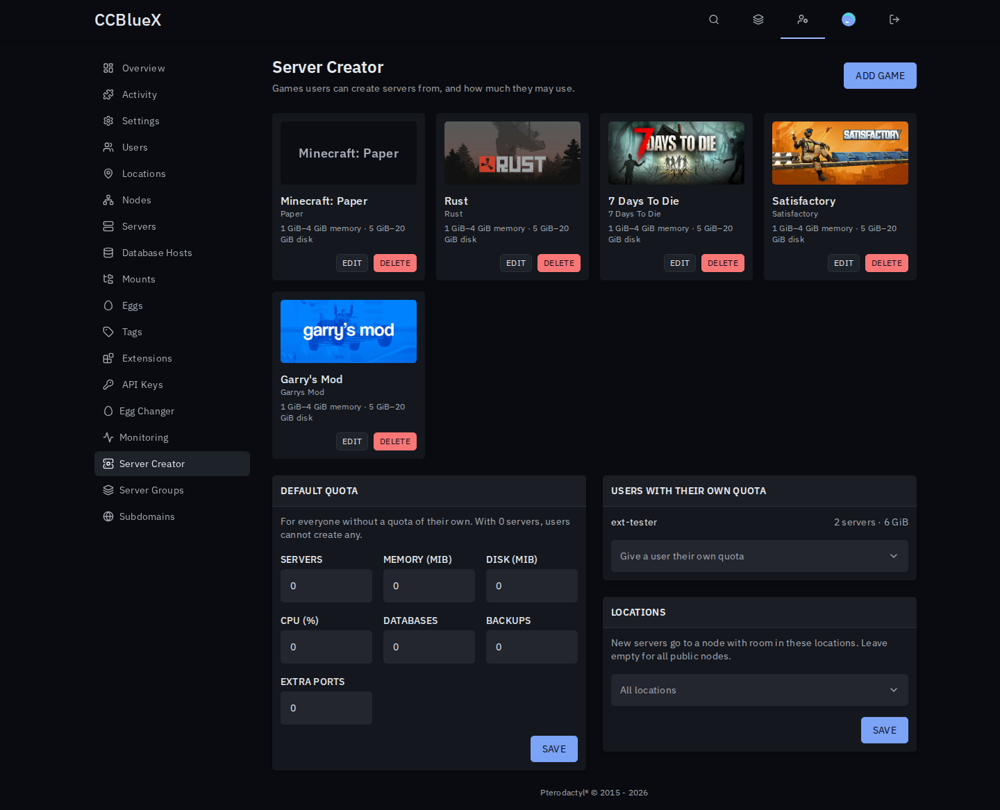

# Server Creator for Pterodactyl

Let users create their own servers within a quota, and duplicate servers in one click.

## Install

1. Download `server-creator-<version>.pteroext` from the [latest release](https://github.com/1zun4/Pterodactyl-Extension-Server-Creator/releases/latest).
2. Install and enable it under **Admin → Extensions**.
3. Under **Admin → Server Creator**, add a game and give users a quota.

## Features

- **Game picker**: users pick from the games you offer, with Steam artwork or your own images.
- **Quotas**: limit servers, memory, disk, CPU, databases, backups and ports, for everyone or per user.
- **Resize and delete**: owners change their server's resources on its Settings page. Deleting is opt-in.
- **Safe placement**: new servers only go to nodes with room, in the locations you choose.
- **Duplicate**: copy any server from its admin page, optionally with all its files.

Users only see the **Create server** button once their quota allows at least one server. The default quota is 0.

---

Inspired by the Pelican plugins User Creatable Servers, User Game Server Creator, Egg Images and Duplicate Server.
